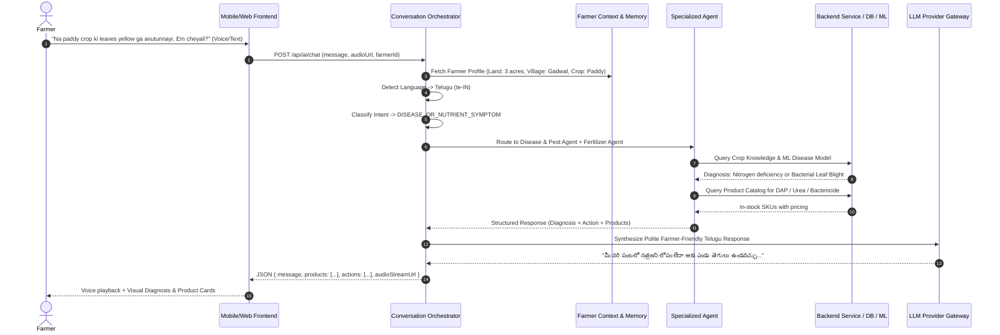

# Kissan Mithar Multi-Agent Conversational AI Architecture
## Agent Specifications, Tool Registry & Safety Guardrails

---

### 1. Architectural Philosophy

The Kissan Mithar AI assistant avoids monolithic system prompts that cause hallucination, high latency, and high token costs. Instead, it employs a **deterministic-first, multi-agent tool-calling architecture**:

1. **Deterministic Router:** The conversation orchestrator determines user intent, user language, and farmer context.
2. **Specialized Single-Responsibility Agents:** Each domain is handled by a dedicated agent with a strict schema and dedicated tools.
3. **Provider-Agnostic Core:** The LLM abstraction layer decouples business logic from specific vendors (Gemini 1.5 Pro, GPT-4o, Claude 3.5 Sonnet).
4. **Safety Verification:** High-stakes agronomy operations (e.g. pesticide dosages, machinery transactions, credit) pass through strict deterministic validation before reaching the farmer.

---

### 2. Conversation Orchestrator



#### Orchestrator Responsibilities:
* **Language Detection:** Detects Telugu (Native script or Telugish Roman script), Hindi (Devanagari or Hinglish), and English.
* **Context Hydration:** Injects the farmer's land size, location, current crop, soil type, and past requests into the conversation memory.
* **Intent Routing:** Routes requests directly to the responsible domain agent.
* **Response Synthesis:** Converts structured tool outputs into polite, simple, empathetic language suitable for rural farmers.

---

### 3. Detailed Agent Specifications (12 Specialized Agents)

#### Agent A: Crop Intelligence Agent
* **Role:** Advises on crop selection, variety recommendations, sowing calendars, stage-specific crop care, irrigation schedules, and harvesting timing.
* **Inputs:** `cropType`, `landAcres`, `soilType`, `season`, `waterSources`, `location`
* **Outputs:** Crop suitability score, recommended seed varieties, sowing window, expected yield, and stage-by-stage crop management plan.
* **Tools Available:**
  * `queryCropAdvisories(crop, season)`: Fetches verified state agricultural university crop guides.
  * `callMLCropPredictor(soilNPK, climate)`: Executes the XGBoost crop suitability model.
  * `getHistoricalYieldData(district, crop)`: Retrieves benchmark regional yields.
* **Failure Handling:** If weather or soil data is missing, prompts farmer for soil type and irrigation availability before advising.

#### Agent B: Soil Intelligence Agent
* **Role:** Interprets soil health card reports, analyzes pH, organic carbon, and NPK deficiency levels, and formulates reclamation steps.
* **Inputs:** `soilReportId`, `soilType`, `nitrogen`, `phosphorus`, `potassium`, `ph`, `ec`
* **Outputs:** Nutrient deficiency assessment, corrective amendments (e.g. gypsum, lime, bio-fertilizers), and suitability ratings for major crops.
* **Tools Available:**
  * `parseSoilHealthCardOCR(documentUrl)`: OCR extraction of laboratory soil test values.
  * `calculateNPKDeficit(soilValues, targetCrop)`: Computes exact nutrient deficit in kg/acre.
  * `bookSoilTestCollection(farmerId, gps)`: Schedules doorstep soil sample collection by Kissan Mithar field agents.

#### Agent C: Disease and Pest Intelligence Agent
* **Role:** Identifies crop diseases and pest infestations from symptoms or leaf photos, determines causal organisms, and prescribes integrated pest management (IPM) solutions.
* **Inputs:** `cropType`, `affectedPart`, `symptomDescription`, `photoUrls`, `voiceTranscript`
* **Outputs:** Disease name, causal organism (fungal, bacterial, viral, pest), severity level, immediate emergency action, verified chemical treatment, organic alternatives, and prevention.
* **Tools Available:**
  * `callMLDiseaseVisionModel(photoUrl)`: Evaluates leaf images via MobileNetV2/ResNet CNN.
  * `queryDiseaseTreatmentDB(crop, diseaseName)`: Pulls CIBRC-registered chemical treatments.
  * `createDiseaseRequest(farmerId, payload)`: Automatically escalates to certified human agronomist if ML confidence is under 75%.
* **Safety Mandate:** Never hallucinates pesticide active ingredients or dosages. Always appends the safe chemical application disclaimer.

#### Agent D: Fertilizer Intelligence Agent
* **Role:** Generates balanced fertilizer schedules matching basal, vegetative, flowering, and fruiting stages, preventing over-fertilization.
* **Inputs:** `cropType`, `cropAge`, `landAcres`, `problemCategory`, `soilType`
* **Outputs:** Stage-wise fertilizer application schedule (date, fertilizer name, exact dosage per acre, application method: fertigation, foliar spray, broadcasting).
* **Tools Available:**
  * `calculateFertilizerDose(crop, acres, age)`: Deterministic formula for standard fertilizer requirements.
  * `matchFertilizerWithCatalog(nutrients)`: Finds matching commercial fertilizers (e.g. IFFCO DAP, 19:19:19, Urea) in stock.
  * `createFertilizerPlan(requestId, planData)`: Saves formal advisory to the farmer's account.

#### Agent E: Weather Intelligence Agent
* **Role:** Delivers hyper-local 5-day weather forecasts and translates meteorological parameters into actionable agricultural advice.
* **Inputs:** `latitude`, `longitude`, `farmerLocation`
* **Outputs:** Temperature, precipitation probability, wind speed, humidity, and agronomic spray/irrigation feasibility warnings.
* **Tools Available:**
  * `fetchLiveWeather(lat, lon)`: Calls cached OpenWeatherMap proxy.
  * `getAgriWeatherAdvisory(weatherData, crop)`: Formulates spray condition alerts (e.g., "Do not spray fungicide today due to 70% rain probability and 22 km/h winds").

#### Agent F: Machinery Booking Agent
* **Role:** Discovers and books tractors, harvesters, drone sprayers, and rotavators within the farmer's mandal/district.
* **Inputs:** `machineryType`, `startDate`, `acres`, `location`, `maxHourlyRate`
* **Outputs:** Available machinery operators, distance from farm, hourly rates, and confirmation of booking requests.
* **Tools Available:**
  * `searchAvailableMachinery(type, gps, radiusKm)`: Queries verified equipment vendors.
  * `createMachineryBooking(farmerId, machineryId, dates)`: Registers booking with status tracking.
  * `getBookingStatus(bookingId)`: Real-time status retrieval.

#### Agent G: Labour Booking Agent
* **Role:** Matches farmers needing farm operations (weeding, transplanting, harvesting) with local labour groups and provides transparent wage discovery.
* **Inputs:** `taskType`, `labourersRequired`, `preferredStartDate`, `durationDays`, `dailyWage`
* **Outputs:** Matched labour pools, estimated total budget, transport/meal specifications, and booking confirmation.
* **Tools Available:**
  * `createLabourRequest(farmerId, payload)`: Calls `LabourService.createRequest()`.
  * `findLocalLabourPools(mandal, taskType)`: Searches regional labour coordinators.
  * `checkLabourBookingStatus(requestId)`: Tracks allocation progress.

#### Agent H: Expert Booking Agent
* **Role:** Connects farmers with certified agronomists and horticulture specialists for 1-on-1 voice, video, or in-person consultations.
* **Inputs:** `specialization`, `consultationMode`, `preferredDate`, `farmerLanguage`
* **Outputs:** Available expert profiles, ratings, appointment time slots, and booking confirmations.
* **Tools Available:**
  * `getAvailableExperts(specialization, language)`: Queries active experts in `Expert` table.
  * `scheduleConsultation(farmerId, expertId, time, mode)`: Inserts record into `Consultation` table.

#### Agent I: Agri Bazaar / Procurement Agent
* **Role:** Facilitates direct crop selling and bulk procurement, eliminating exploitative middlemen for farm produce.
* **Inputs:** `commodity`, `variety`, `estimatedQuantity`, `quantityUnit`, `expectedPrice`, `location`
* **Outputs:** Live listing creation, matching verified buyers, and procurement status updates.
* **Tools Available:**
  * `createAgriListing(farmerId, listingData)`: Creates `AgriProductListing` record.
  * `findMatchingBuyers(commodity, quantity, district)`: Queries `AgriProductRequest` table.
  * `trackProcurementStatus(listingId)`: Returns deal status from `AgriProductRequestHistory`.

#### Agent J: Mandi Intelligence Agent
* **Role:** Provides real-time APMC mandi prices, price comparisons across neighbouring markets, and price trends (Up / Down / Stable).
* **Inputs:** `commodity`, `market`, `state`, `district`
* **Outputs:** Min, max, and modal prices (INR/quintal), price trends, and nearby market price differentials.
* **Tools Available:**
  * `getMandiPrices(commodity, state, market)`: Calls `MandiPriceService.getPrices()`.
  * `compareNearbyMandis(commodity, userGps)`: Finds best market price within 100km radius.
  * `getMandiPriceTrend(commodity, days)`: Analyzes historical price movements.

#### Agent K: Commerce & Product Recommendation Agent
* **Role:** Translates diagnostic advisories directly into relevant, available farm inputs (seeds, fertilizers, bio-pesticides, tools), manages cart operations, and drives checkout.
* **Inputs:** `category`, `searchQuery`, `targetCrop`, `cartAction` (add, remove, view, checkout)
* **Outputs:** Rich interactive product cards (image, brand, price, dosage, pack size), cart updates, and payment checkout links.
* **Tools Available:**
  * `searchProducts(query, category, inStockOnly)`: Queries `ProductCatalog` table.
  * `manageCart(farmerId, action, productId, quantity)`: Updates `Cart` and `CartItem` tables.
  * `initiateOrderCheckout(farmerId, cartId, paymentMode)`: Creates `Order` and generates payment intent.
  * `trackFarmerOrders(farmerId)`: Retrieves real-time delivery status.

#### Agent L: Government Schemes & Best Practice Agent
* **Role:** Informs farmers about eligible central and state government subsidies (PM-KISAN, Rythu Bandhu, drip irrigation subsidies, crop insurance PMFBY).
* **Inputs:** `farmerState`, `landAcres`, `cropType`, `category`
* **Outputs:** Scheme details, subsidy percentage, eligibility criteria, required documents, and application links.
* **Tools Available:**
  * `queryGovernmentSchemesRAG(query, state)`: Semantic search over verified scheme corpus.

---

### 4. Tool Registry Specification

Every agent interacts with the underlying infrastructure through standardized TypeScript tool definitions adhering to JSON Schema specifications:

```typescript
export interface AgentTool<TInput = any, TOutput = any> {
  name: string;
  description: string;
  parameters: {
    type: 'object';
    properties: Record<string, any>;
    required: string[];
  };
  execute: (args: TInput, context: FarmerContext) => Promise<TOutput>;
}
```

```
+---------------------------------------------------------------------------------------------+
|                                    TOOL REGISTRY MATRIX                                     |
+------------------------------------+----------------------------+---------------------------+
| Tool Name                          | Owning Agent               | Underlying Service        |
+------------------------------------+----------------------------+---------------------------+
| `catalog_search_products`          | Commerce & Product         | `ProductCatalogService`   |
| `cart_add_item`                    | Commerce & Product         | `CartService`             |
| `cart_view`                        | Commerce & Product         | `CartService`             |
| `checkout_initiate_order`          | Commerce & Product         | `OrderService`            |
| `disease_predict_image`            | Disease & Pest             | `FastAPIService /predict` |
| `disease_query_treatment`          | Disease & Pest             | `DiseaseService`          |
| `fertilizer_calculate_dosage`      | Fertilizer Intelligence    | `FertilizerService`       |
| `mandi_get_live_prices`            | Mandi Intelligence         | `MandiPriceService`       |
| `mandi_compare_markets`            | Mandi Intelligence         | `MandiPriceService`       |
| `weather_get_forecast`             | Weather Intelligence       | `WeatherService`          |
| `machinery_search_providers`       | Machinery Booking          | `MachineryService`        |
| `labour_create_request`            | Labour Booking             | `LabourService`           |
| `consultation_book_expert`         | Expert Booking             | `ConsultationService`     |
| `agri_bazaar_create_listing`       | Agri Bazaar / Procurement  | `AgriBazaarService`       |
| `rag_query_agricultural_corpus`    | All Agronomy Agents        | `RAGVectorService`        |
| `farmer_update_memory`             | Orchestrator               | `FarmerContextService`    |
+------------------------------------+----------------------------+---------------------------+
```

---

### 5. LLM Provider Abstraction Layer

To ensure resilient operation independent of any single provider, all agents communicate via an abstracted gateway:

```typescript
export interface LLMMessage {
  role: 'system' | 'user' | 'assistant' | 'tool';
  content: string;
  name?: string;
  toolCallId?: string;
  toolCalls?: Array<{
    id: string;
    function: { name: string; arguments: string };
  }>;
}

export interface LLMProvider {
  chat(messages: LLMMessage[], tools?: AgentTool[]): Promise<{
    message: string;
    toolCalls?: Array<{ id: string; name: string; arguments: any }>;
  }>;
  streamChat(messages: LLMMessage[], onChunk: (chunk: string) => void): Promise<string>;
  generateEmbeddings(text: string): Promise<number[]>;
}
```

* **Primary Provider:** Google Gemini 1.5 Pro / Flash via `@google/genai` (low latency, rich multilingual capabilities in Indian regional languages, native multimodal vision).
* **Fallback Provider:** OpenAI GPT-4o / Claude 3.5 Sonnet (automatically engaged if primary provider exceeds latency threshold or rate limits).

---

### 6. Farmer Context & Memory Architecture

Rural farmers do not remember technical details or previous dates. The system maintains an intelligent memory system:

```
                               +-----------------------------+
                               |     FARMER CONTEXT BUS      |
                               +--------------+--------------+
                                              |
                     +------------------------+------------------------+
                     |                                                 |
                     v                                                 v
      +-----------------------------+                   +-----------------------------+
      |      SHORT-TERM MEMORY      |                   |      LONG-TERM MEMORY       |
      |   (Active Chat Session)     |                   |    (Persistent Database)    |
      +-----------------------------+                   +-----------------------------+
      | - Conversation transcript   |                   | - Total land acreage        |
      | - Recently referenced crop  |                   | - Soil health profile (NPK) |
      | - Active cart contents      |                   | - Dominant crops (by season)|
      | - Current selected language |                   | - Machinery owned/leased    |
      | - Last mentioned issue      |                   | - Language preference       |
      | - In-flight booking draft   |                   | - Purchase & enquiry history|
      +-----------------------------+                   +-----------------------------+
```

* **Consent & Privacy Compliance:** Before persistent agricultural facts (such as farm boundaries, past yields, or credit preferences) are committed to long-term memory, the assistant explicitly asks: *"May I save your soil details and land size so I can give you personalized farming guidance in the future?"*
