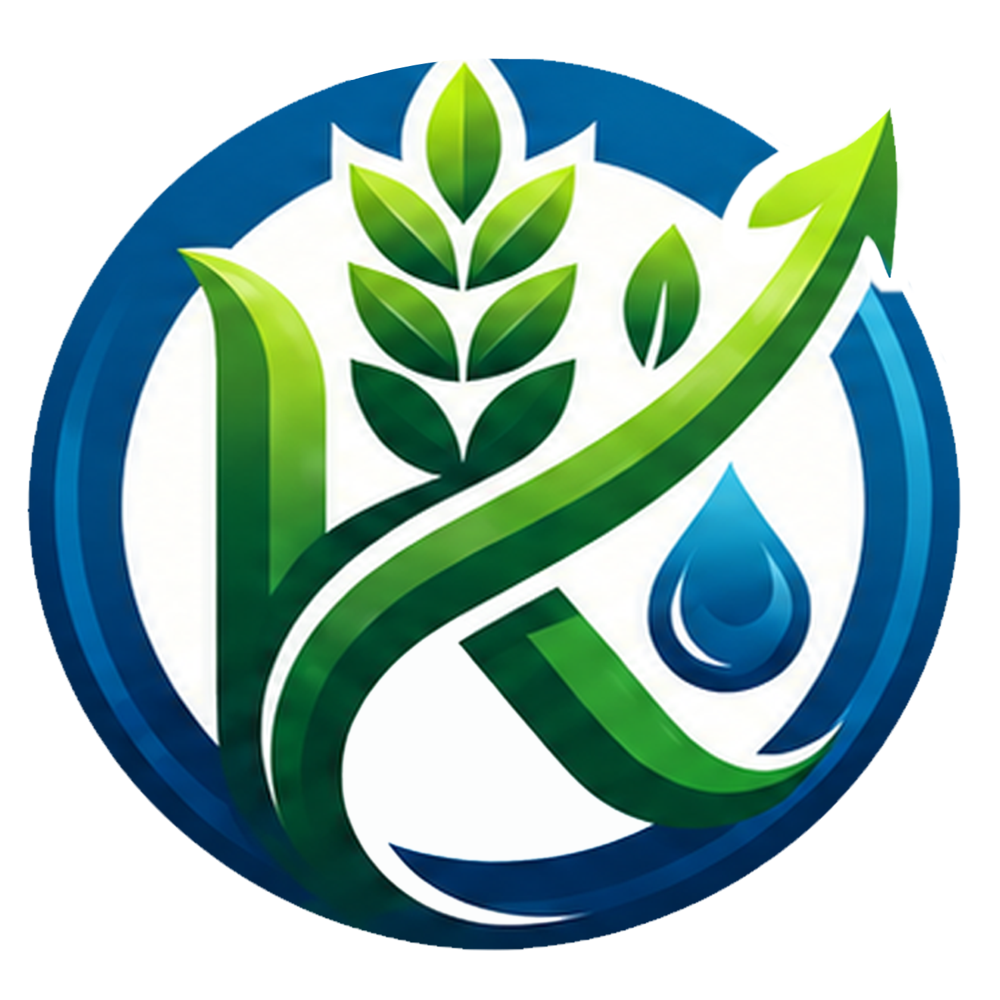
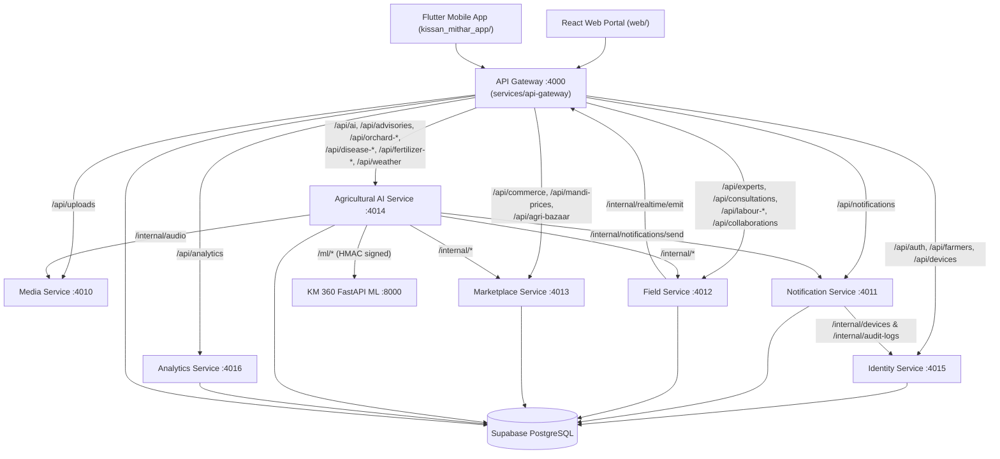

# 🌾 Kissan Mithar (కిసాన్ మిత్ర / किसान मित्र / ಕಿಸಾನ್ ಮಿತ್ರ)

<p align="center">
  
</p>

<p align="center">
  <strong>AI-Powered Agricultural Super-Platform & Microservices Ecosystem</strong><br>
  Empowering Indian smallholder farmers with conversational AI agronomy, KM 360 ML crop intelligence, scientific orchard planning, tele-agronomy consultations, Agri-Bazaar marketplace trading, labour &amp; machinery coordination, and offline-resilient mobile access.
</p>

<p align="center">
  
  
  
  
  
  
  
</p>

---

## 📖 Table of Contents
- [🌟 Key Capabilities](#-key-capabilities)
  - [1. Mobile Application (`kissan_mithar_app`)](#1-mobile-application-kissan_mithar_app)
  - [2. Web Portal & Admin Dashboard (`web`)](#2-web-portal--admin-dashboard-web)
  - [3. Microservices Backend (`services`) & ML Engine (`KM_360`)](#3-microservices-backend-services--ml-engine-km_360)
- [🏛️ Microservices Architecture](#️-microservices-architecture)
- [📁 Repository Structure](#-repository-structure)
- [🌐 Multilingual Support](#-multilingual-support)
- [🚀 Getting Started](#-getting-started)
  - [Option A — Full Platform via Docker Compose](#option-a--full-platform-via-docker-compose)
  - [Option B — Local Service-by-Service Setup](#option-b--local-service-by-service-setup)
- [🧪 Running Automated Tests](#-running-automated-tests)
- [📚 Documentation](#-documentation)
- [📱 Google Play Store Publishing](#-google-play-store-publishing)

---

## 🌟 Key Capabilities

### 1. Mobile Application (`kissan_mithar_app`)
- **Conversational AI Assistant & Voice First Interface**: Multilingual AI chat (English, Telugu, Hindi, Kannada) with voice notes, RAG agronomic advisory, and interactive in-chat product/booking cards.
- **3-Step Orchard Planning Wizard & Tracker**: 4-angle land photography, GPS boundary capture, crop/soil selection, audio notes, 5-stage live tracking, and 11-section PDF feasibility reports.
- **Tele-Agronomy Consultations**: Voice, Video, and Chat consultations with certified agronomists and digital prescriptions.
- **Agri-Bazaar, Commerce, Labour & Weather**: Crop produce buying/selling, agricultural input ordering, farm labour requests, mandi prices, hyperlocal forecasts, and spray-delay alerts.
- **Offline Resiliency**: Local draft auto-saving, sync queues, and cached PDF vault.

### 2. Web Portal & Admin Dashboard (`web`)
- **Public Landing & Partnerships Pages**: Service catalog showcase and enterprise/partnership onboarding.
- **Agronomist & Admin Consoles**: Live request inspection, multi-angle image viewer, audio playback, 11-section feasibility report PDF generator (`jsPDF`), Agri-Bazaar/Labour moderation, Socket.IO real-time updates, broadcast notifications, and system health telemetry.

### 3. Microservices Backend (`services`) & ML Engine (`KM_360`)
All backend domains run as independently deployable microservices behind the API Gateway:

| Service | Port | Directory | Responsibilities |
| :--- | :---: | :--- | :--- |
| **API Gateway** | `4000` | `services/api-gateway/` | Edge routing, JWT auth, RBAC, rate limits, Socket.IO hub (`/internal/realtime/emit`), Admin orchestration |
| **Media Service** | `4010` | `services/media-service/` | Cloudinary upload signing and voice audio storage (`/api/uploads/*`, `/internal/audio`) |
| **Notification Service** | `4011` | `services/notification-service/` | Farmer notification inbox, FCM push dispatch, and broadcast campaigns |
| **Field Service** | `4012` | `services/field-service/` | Experts, consultations, labour requests, partnerships/collaborations, machinery availability |
| **Marketplace Service** | `4013` | `services/marketplace-service/` | Conversational commerce catalog/orders, mandi prices, Agri-Bazaar listings & matches |
| **Agricultural AI Service** | `4014` | `services/agricultural-ai-service/` | LLM orchestrator, RAG, memory/sessions, orchard, disease, fertilizer, advisories, weather |
| **Identity & Farmer Service** | `4015` | `services/identity-service/` | Phone/Email OTP, password auth, JWT issuance, farmer profiles/dossier, devices, audit logs, cleanup timer |
| **Analytics Service** | `4016` | `services/analytics-service/` | Executive & overview platform analytics and `/metrics` service telemetry |
| **KM 360 ML Service** | `8000` | `KM_360/` | Python FastAPI inference for Crop Recommendation, Soil Health, Fertilizer STCR, Disease Vision, Yield Prediction, Smart Irrigation |

---

## 🏛️ Microservices Architecture



---

## 📁 Repository Structure

```
Kissan Mithar/
├── docker-compose.platform.yml          # Full 9-service container orchestration
├── README.md
│
├── services/                            # ⚙️ Node.js + TypeScript Microservices
│   ├── api-gateway/                     # Edge API Gateway, Socket.IO, Admin (:4000)
│   ├── identity-service/                # Auth, Farmers, Devices, Audit, Cleanup (:4015)
│   ├── agricultural-ai-service/         # LLM Orchestrator, RAG, Crop/Soil/Weather (:4014)
│   ├── marketplace-service/             # Commerce, Mandi Prices, Agri-Bazaar (:4013)
│   ├── field-service/                   # Experts, Consultations, Labour, Collaborations (:4012)
│   ├── media-service/                   # Cloudinary Signing & Voice Audio (:4010)
│   ├── notification-service/            # Notifications & FCM Push (:4011)
│   └── analytics-service/               # KPI Aggregations & Telemetry (:4016)
│
├── KM_360/                              # 🧠 Python FastAPI Machine Learning Service (:8000)
│   ├── app/                             # FastAPI entrypoint, routers, inference pipelines
│   ├── models/                          # Trained model artifacts & registries
│   ├── training/                        # Model training scripts
│   ├── data/                            # Raw & processed datasets
│   ├── tests/ & test_ml_service.py      # ML automated suites
│   └── Dockerfile.ml
│
├── web/                                 # 💻 React + TypeScript + Vite Web App
│   ├── public/                          # Brand & UI static assets
│   └── src/                             # Public pages, Farmer/Expert/Admin UI, Socket client
│
├── kissan_mithar_app/                   # 📱 Flutter Mobile Application
│   ├── android/ & ios/
│   ├── assets/                          # Soil, crop, service, and UI images
│   ├── lib/                             # Core config, l10n, and modular feature packages
│   └── test/                            # Flutter unit & widget tests
│
├── docs/                                # 📐 Platform Architecture & Migration Specs
├── nginx/                               # Reverse proxy config (kissan-mithar.conf)
└── play_store_listing/                  # 📦 Localized Store Metadata (EN, TE, HI, KN)
```

---

## 🌐 Multilingual Support

The Flutter app natively supports 4 languages via `.arb` localization files:

| Language | Code | Native Name | ARB Resource |
| :--- | :---: | :---: | :--- |
| **English** | `en` | English | [`kissan_mithar_app/lib/l10n/app_en.arb`](kissan_mithar_app/lib/l10n/app_en.arb) |
| **Telugu** | `te` | తెలుగు | [`kissan_mithar_app/lib/l10n/app_te.arb`](kissan_mithar_app/lib/l10n/app_te.arb) |
| **Hindi** | `hi` | हिंदी | [`kissan_mithar_app/lib/l10n/app_hi.arb`](kissan_mithar_app/lib/l10n/app_hi.arb) |
| **Kannada** | `kn` | ಕನ್ನಡ | [`kissan_mithar_app/lib/l10n/app_kn.arb`](kissan_mithar_app/lib/l10n/app_kn.arb) |

---

## 🚀 Getting Started

### Prerequisites
- **Node.js**: `>= 20.0.0` & `npm >= 9.0.0`
- **Python**: `>= 3.11` (for `KM_360/`)
- **Flutter SDK**: `>= 3.19.0` (for `kissan_mithar_app/`)
- **PostgreSQL / Supabase** & **Docker** (for containerized orchestration)

### Option A — Full Platform via Docker Compose

Ensure `services/api-gateway/.env` is configured from `services/api-gateway/.env.example`, then launch all 9 services:

```bash
docker compose -f docker-compose.platform.yml up -d --build
```

Gateway health probe will be live at `http://localhost:4000/health` and `/api/health`.

### Option B — Local Service-by-Service Setup

1. **API Gateway & Node Microservices** (repeat per folder in `services/*`):
   ```bash
   cd services/api-gateway   # or any service under services/
   cp .env.example .env
   npm install
   npm run build
   npm run dev
   ```
2. **KM 360 Python ML Service (`port 8000`)**:
   ```bash
   cd KM_360
   python3 -m venv .venv && source .venv/bin/activate
   pip install -r requirements.txt
   uvicorn app.main:app --host 0.0.0.0 --port 8000 --reload
   ```
3. **Web Frontend (`web`, `port 5173`)**:
   ```bash
   cd web
   npm install
   npm run dev
   ```
4. **Flutter Mobile App (`kissan_mithar_app`)**:
   ```bash
   cd kissan_mithar_app
   flutter pub get
   flutter gen-l10n
   flutter run
   ```

---

## 🧪 Running Automated Tests

- **API Gateway & Full 7-Service End-to-End Integration**:
  ```bash
  cd services/api-gateway
  npm test
  ```
- **Individual Microservice Suites**:
  ```bash
  for svc in media-service notification-service field-service marketplace-service agricultural-ai-service identity-service analytics-service; do
    (cd "services/$svc" && npm test)
  done
  ```
- **KM 360 ML Inference Suite**:
  ```bash
  cd KM_360
  ./.venv/bin/python test_ml_service.py
  ```
- **Web Production Build Check**:
  ```bash
  cd web && npm run build
  ```
- **Flutter Unit & Widget Tests**:
  ```bash
  cd kissan_mithar_app && flutter test
  ```

---

## 📚 Documentation

- **Platform Architecture & Specs (`docs/`)**:
  - [SYSTEM_ARCHITECTURE.md](docs/SYSTEM_ARCHITECTURE.md)
  - [TARGET_MICROSERVICES_ARCHITECTURE.md](docs/TARGET_MICROSERVICES_ARCHITECTURE.md)
  - [CONTROLLER_SERVICE_MAPPING.md](docs/CONTROLLER_SERVICE_MAPPING.md)
  - [DATABASE_OWNERSHIP.md](docs/DATABASE_OWNERSHIP.md)
  - [SERVICE_COMMUNICATION.md](docs/SERVICE_COMMUNICATION.md)
  - [DEPLOYMENT_ARCHITECTURE.md](docs/DEPLOYMENT_ARCHITECTURE.md)
  - [MIGRATION_PLAN.md](docs/MIGRATION_PLAN.md)
  - [ROLLBACK_PLAN.md](docs/ROLLBACK_PLAN.md)
- **Domain Specifications (`services/*` & `KM_360/`)**:
  - [API Documentation](services/api-gateway/API_DOCUMENTATION.md)
  - [AI Agent Design](services/agricultural-ai-service/AI_AGENT_DESIGN.md), [RAG System Design](services/agricultural-ai-service/RAG_SYSTEM_DESIGN.md), [Voice Architecture](services/agricultural-ai-service/VOICE_ARCHITECTURE.md)
  - [Commerce Engine](services/marketplace-service/COMMERCE_ENGINE.md) & [Service Integration Guide](services/field-service/SERVICE_INTEGRATION_GUIDE.md)
  - [KM 360 ML Architecture](KM_360/ML_ARCHITECTURE.md) & [ML API Docs](KM_360/ML_API_DOCUMENTATION.md)

---

## 📱 Google Play Store Publishing

Localized store listing copy and checklists live under [`play_store_listing/`](play_store_listing/):
- [English (`en_US.md`)](play_store_listing/en_US.md)
- [Telugu (`te_IN.md`)](play_store_listing/te_IN.md)
- [Hindi (`hi_IN.md`)](play_store_listing/hi_IN.md)
- [Kannada (`kn_IN.md`)](play_store_listing/kn_IN.md)
