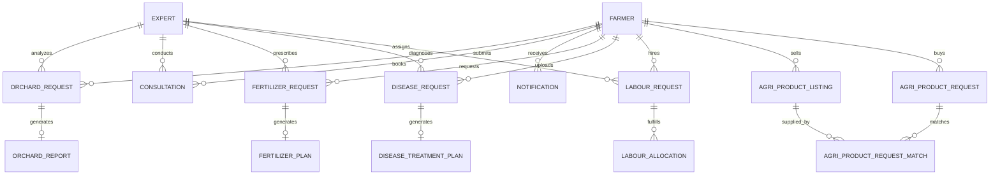
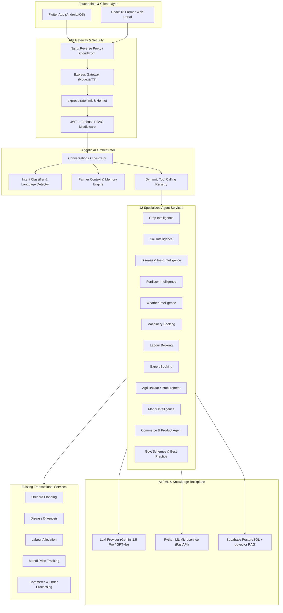

# Kissan Mithar Agricultural AI & Conversational Commerce Platform
## System Architecture & Technical Audit Specification

---

### 1. Executive Summary & Audit Overview

**Kissan Mithar** is an enterprise-grade agricultural ecosystem operating in India that bridges rural farmers with certified agronomy experts, dynamic farm labour pools, equipment logistics, agricultural produce markets (*Agri-Bazaar*), and real-time mandi intelligence.

This document serves as the foundational architectural blueprint for transforming Kissan Mithar from a transactional multi-platform web/mobile utility into an **autonomous, conversational, multi-agent agricultural ecosystem**.

```
                           +-------------------------------------------------------------+
                           |                     FARMER TOUCHPOINTS                      |
                           |  [Flutter Android/iOS App]   |   [React 18 Web Portal]      |
                           |  - Voice (Telugu/Hindi/Eng)  |   - Interactive Chat Drawer  |
                           |  - Camera Leaf Snap & OCR    |   - Visual Commerce Cards    |
                           +------------------------------+------------------------------+
                                                          |
                                      HTTPS / WSS / REST  |  JWT Bearer Auth
                                                          v
                           +-------------------------------------------------------------+
                           |           KISSAN MITHAR BACKEND GATEWAY (Node.js)           |
                           |  - Rate Limiting (express-rate-limit) | Helmet & CORS       |
                           |  - Dual Auth: Firebase Auth (Farmer) + JWT/RBAC (Staff)     |
                           |  - Realtime Events (Socket.IO Staff & Farmer Rooms)         |
                           +------------------------------+------------------------------+
                                                          |
                                           Internal Event / Service Bus
                                                          |
               +------------------------------------------+------------------------------------------+
               |                                                                                     |
               v                                                                                     v
+-------------------------------+                                             +-------------------------------+
|     AI AGENT ORCHESTRATOR     |                                             |   EXISTING SERVICE DOMAINS    |
| (Multi-Agent Routing Engine)  |                                             | - Orchard Planning Service    |
| - Language Detection (TE/HI/EN)                                             | - Fertilizer Advisory Service |
| - Intent Classification       |                                             | - Disease Diagnosis Service   |
| - Memory & Context Engine     |                                             | - Labour Booking & Allocation |
| - Tool Calling Registry       |                                             | - Agri-Bazaar Marketplace     |
| - Safety & Guardrail Filters  |                                             | - Mandi Price Intelligence    |
+---------------+---------------+                                             +---------------+---------------+
                |                                                                             |
     +----------+----------+------------------------------------------------------------------+
     |                     |                                 |
     v                     v                                 v
+------------------+ +-------------------+ +----------------------------------+
| AGRICULTURAL RAG | |   ML INFERENCE    | |      CONVERSATIONAL COMMERCE     |
|   (pgvector)     | |  (Python FastAPI) | | - Product Catalog & SKU Search   |
| - ICAR Corpus    | | - Crop Prediction | | - In-Chat Cart Management        |
| - University Pkg | | - Disease CNN     | | - Order Lifecycle & Checkout     |
| - Verified Guides| | - Yield Forecast  | | - Digital Payment Gateway        |
+------------------+ +-------------------+ +----------------------------------+
```

---

### 2. Current Codebase Audit

#### 2.1 Technology Stack Inventory

| Component | Technology | Version | Location in Monorepo |
| :--- | :--- | :--- | :--- |
| **Backend API** | Node.js, Express, TypeScript | Node 20+, Express 4.21, TS 5.6 | `/backend` |
| **Database & ORM** | PostgreSQL (Supabase with PgBouncer), Prisma ORM | Prisma 5.19.1, PostgreSQL 15 | `/backend/prisma` |
| **Mobile Application** | Flutter, Dart, Riverpod, GoRouter, Dio | Flutter 3.24+, Dart 3.5 | `/kissan_mithar_app` |
| **Web Application** | React, Vite, TypeScript, Axios, Lucide Icons | React 18.3, Vite 5.4, TS 5.6 | `/web` |
| **Media Storage** | Cloudinary CDN & Express Static File Server | Cloudinary SDK 2.5 | `/backend/src/services/upload.service.ts` |
| **Real-time Engine** | Socket.IO | Socket.IO 4.7.5 | `/backend/src/config/socket.ts` |
| **Cloud Deployment** | Dual-target: AWS Lambda (SAM) & AWS EC2 (Docker/PM2) | SAM CLI / Docker Compose | `template.yaml`, `docker-compose.yml` |

#### 2.2 Database Schema Audit (Current 22 Models)



* **Core Identity:** `Farmer` (Firebase UID, phone, location, land acres, primary crop), `Expert` (specialization, experience, staff role), `Admin` (RBAC staff roles), `AuthAuditLog`, `EmailOtp`, `Device`.
* **Agronomy Operations:** `OrchardRequest`, `OrchardReport`, `Consultation`, `CropAdvisory`, `OfflineDraft`, `FertilizerRequest`, `FertilizerPlan`, `DiseaseRequest`, `DiseaseTreatmentPlan`, `LabourRequest`, `LabourAllocation`.
* **Marketplace & Sourcing:** `MandiPrice` (commodity, market, min/max/modal prices, trends), `AgriProductListing`, `AgriProductRequest`, `AgriProductRequestMatch`, `AgriProductRequestHistory`.
* **Corporate Partnerships:** `CollaborationRequest`, `CollaborationAuditLog`, `CollaborationInternalNote`.

#### 2.3 Backend Endpoint & Service Inventory (80+ Endpoints)

| Route Group | Base Path | Core Capabilities | Controller & Service |
| :--- | :--- | :--- | :--- |
| **Auth & Staff** | `/api/auth` | Firebase verify, OTP issue/verify, staff login, refresh token, audit logging | `auth.controller.ts`, `auth.service.ts` |
| **Farmers** | `/api/farmers` | Profile retrieval, update land acres/crops/location, notifications, device tokens | `farmer.controller.ts`, `farmer.service.ts` |
| **Orchard Advisory** | `/api/orchard-requests` | 5-angle survey map ingestion, GPS bounding, agronomist assignment, PDF generation | `orchard.controller.ts`, `orchard.service.ts` |
| **Fertilizer Advisory**| `/api/fertilizer-requests` | Soil nutrient analysis, crop stage diagnosis, custom NPK schedule generation | `fertilizer.controller.ts`, `fertilizer.service.ts` |
| **Disease Diagnosis** | `/api/disease-requests` | Infected leaf upload, symptom speech-to-text, chemical/organic treatment plans | `disease.controller.ts`, `disease.service.ts` |
| **Labour Exchange** | `/api/labour-requests` | Work scheduling (sowing, harvesting, spraying), wage negotiation, crew allocation | `labour.controller.ts`, `labour.service.ts` |
| **Agri-Bazaar** | `/api/agri-bazaar` | Produce listings, procurement bids, sourcing workflows, automated buyer-seller match | `agriBazaar.controller.ts`, `agriBazaar.service.ts` |
| **Mandi Intelligence**| `/api/mandi-prices` | APMC mandi prices, commodity-wise trends, market comparison, price history | `mandi.controller.ts`, `mandi.service.ts` |
| **Weather** | `/api/weather` | OpenWeatherMap integration with localized agronomic forecast & spray alerts | `weather.controller.ts`, `weather.service.ts` |
| **Experts & Admin** | `/api/experts`, `/api/admin` | Staff RBAC, user management, analytics dashboards, consultation management | `expert.controller.ts`, `admin.controller.ts` |

---

### 3. Gap Analysis: Existing vs. Master Prompt Vision

```
+--------------------------------------------------------------------------------------------------+
|                                        GAP AUDIT MATRIX                                          |
+--------------------------+------------------------------+----------------------------------------+
| Functional Domain        | Existing State               | Required Target State (Master Prompt)  |
+--------------------------+------------------------------+----------------------------------------+
| Conversational AI Engine | Mock orchestrator in Flutter | Multi-agent orchestrator with LLM      |
|                          | with 5 static string checks  | provider abstraction (Gemini / OpenAI) |
+--------------------------+------------------------------+----------------------------------------+
| Memory & Context         | Flat farmer profile table;   | Short-term conversation session cache, |
|                          | no conversational history    | long-term farmer memory & consent store|
+--------------------------+------------------------------+----------------------------------------+
| Agricultural RAG         | Static CropAdvisory database | Vector database (pgvector), embeddings |
|                          | text search only             | pipeline for ICAR, SAUs, govt schemes  |
+--------------------------+------------------------------+----------------------------------------+
| Machine Learning Models  | None (pure heuristic & CRUD) | Python FastAPI microservice with:      |
|                          |                              | 1. XGBoost Crop Recommendation         |
|                          |                              | 2. Fertilizer Recommendation Engine    |
|                          |                              | 3. MobileNetV2 Disease CNN             |
|                          |                              | 4. Random Forest Yield Estimator       |
|                          |                              | 5. Soil Classification Pipeline        |
+--------------------------+------------------------------+----------------------------------------+
| Conversational Commerce  | No product catalog, no cart, | In-chat product cards, SKU search,     |
|                          | no order/payment tables      | persistent cart, checkout, payment flow|
+--------------------------+------------------------------+----------------------------------------+
| Service Booking via Chat | Manual multi-step forms in   | Zero-navigation conversational booking |
|                          | web & mobile apps            | of machinery, labour, expert, soil test|
+--------------------------+------------------------------+----------------------------------------+
| Multilingual & Voice     | Flutter client-side speech   | Robust Telugu/Hindi/English NLP engine |
|                          | with mock timer              | with audio ingestion & audio streaming |
+--------------------------+------------------------------+----------------------------------------+
| Web Chat Experience      | None (admin portal only)     | Farmer-facing interactive chat widget  |
|                          |                              | with rich cards, cart, and voice input |
+--------------------------+------------------------------+----------------------------------------+
```

---

### 4. Target Modular Architecture



---

### 5. High-Load Resilience & Safety Architecture (10,000+ Concurrent Farmers)

To guarantee high availability and agricultural safety:

1. **Database Connection Pooling (PgBouncer):**
   * Supabase PgBouncer runs in transaction pooling mode on port `6543`, supporting 10,000+ client connections multiplexed into 50 direct Postgres connections.
   * `backend/src/config/db.ts` automatically binds `?pgbouncer=true&connection_limit=1` to prevent connection exhaustion.
2. **Cold Start & Caching Strategies:**
   * Mandi prices and weather data are cached in-memory with a TTL (1 hour for mandi, 30 mins for weather) to eliminate redundant external API hits.
   * Background warmup routine (`warmupDatabase()`) executes on instance startup.
3. **Graceful Fallbacks & Offline Resilience:**
   * If the LLM provider experiences latency spikes (>4s), the Orchestrator falls back to rule-based intent parsing and returns pre-computed expert recommendations.
   * If the Python ML microservice is unreachable, the backend falls back to deterministic decision tables for crop and fertilizer rules.
4. **Agricultural Safety Guardrails:**
   * **Pesticide / Chemical Dosages:** Under no circumstances will the LLM fabricate or extrapolate chemical dosages. All chemical recommendations are looked up strictly from verified CIBRC (Central Insecticide Board & Registration Committee) database records.
   * **Disclaimer Inclusion:** All medical and agronomic treatment responses automatically append a localized safety disclaimer encouraging field inspection.
