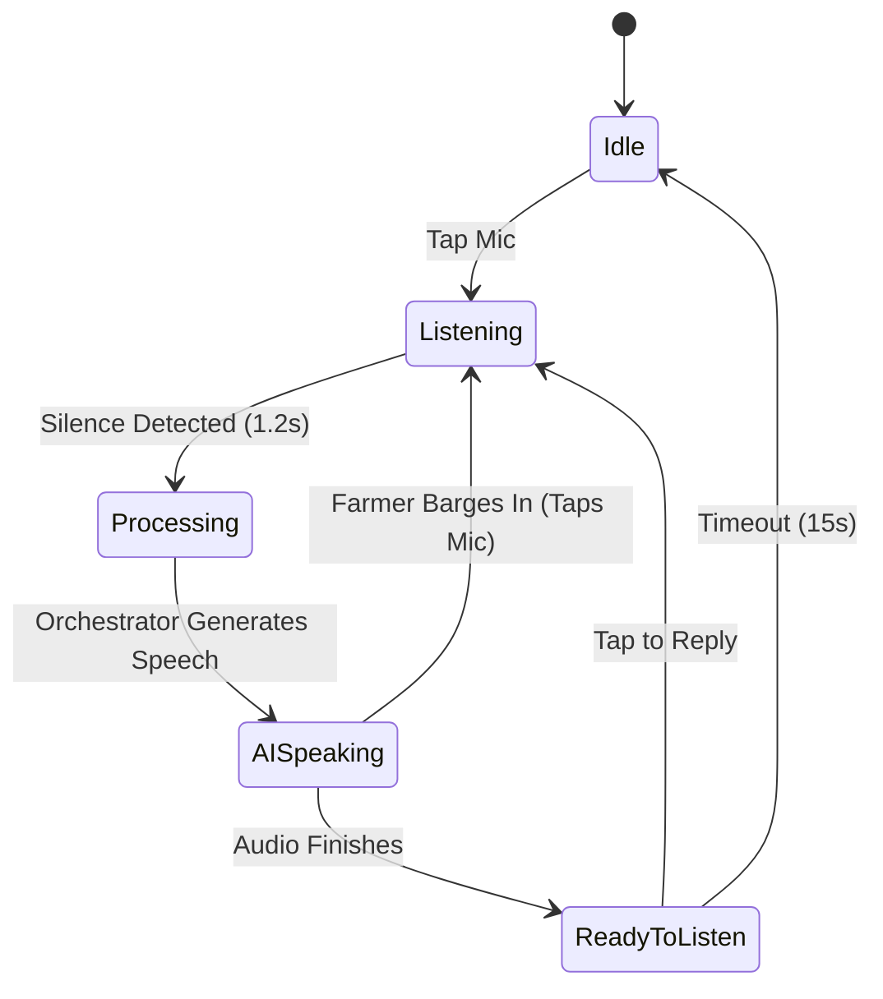

# Kissan Mithar Multilingual Voice & Audio Architecture
## Voice-First Agricultural Interaction (Telugu, Hindi, English)

---

### 1. Vision: Voice as the Primary Interface for Rural Farmers

Many rural farmers face literacy barriers when typing complex botanical or chemical terminology. Kissan Mithar treats **voice as a primary citizen, not an afterthought**:

```
+-----------------------------------------------------------------------------------------+
|                              MULTILINGUAL VOICE PIPELINE                                |
+-----------------------------------------------------------------------------------------+
| 1. AUDIO CAPTURE    | Farmer taps microphone and speaks naturally in native dialect.    |
| 2. STREAMING STT    | Speech-to-Text transcribes Telugu / Hindi / English in real-time. |
| 3. PHONETIC MAPPING | Normalizes agricultural dialect terms (e.g. "Murda తెగులు").       |
| 4. AI AGENT PROCESS | Orchestrator routes intent and retrieves agronomic advice.        |
| 5. NEURAL TTS       | Generates warm, natural, human-sounding voice in regional tongue. |
| 6. SYNCHRONIZED UI  | Plays audio while highlighting key words and visual product cards.|
+-----------------------------------------------------------------------------------------+
```

---

### 2. Supported Languages & Regional Dialect Handling

* **Telugu (`te-IN`):** Supports native Telugu script and colloquial farm terminology (e.g. *"Majjiga తెగులు"*, *"Thota"*, *"Madugu"*, *"Panta"*).
* **Hindi (`hi-IN`):** Supports standard Khari Boli and common rural farming dialects in Central/North India (e.g. *"Kitak"*, *"Rog"*, *"Khad"*, *"Mandi"*).
* **English (`en-IN`):** Indian English with agricultural terminology.

---

### 3. Speech-to-Text (STT) Hybrid Architecture

1. **On-Device Fast STT (Flutter App):** Uses `speech_to_text` package with the device's native Indian English/Hindi/Telugu speech recognizer for instant partial transcripts.
2. **Cloud Neural STT (Web & Audio Uploads):** Backend proxy to Google Cloud Speech-to-Text with specialized language codes (`te-IN`, `hi-IN`) and agricultural vocabulary hints (boosting recognition of pesticide and crop names by +15dB).

---

### 4. Text-to-Speech (TTS) Synthesis

* **On-Device Playback:** Driven by `flutter_tts` with Indian locale bindings (`te-IN`, `hi-IN`).
* **Cloud High-Definition Voice:** Employs neural voices tuned for empathetic, clear rural communication:
  * Telugu: `te-IN-Standard-A`
  * Hindi: `hi-IN-Neural2-A` (Natural female agronomy assistant persona)
  * English: `en-IN-Neural2-D`
* **Interruption Handling:** Farmers can tap anywhere or start speaking to instantly halt AI audio playback (`barge-in capability`).

---

### 5. Mobile & Web Audio Interaction States


