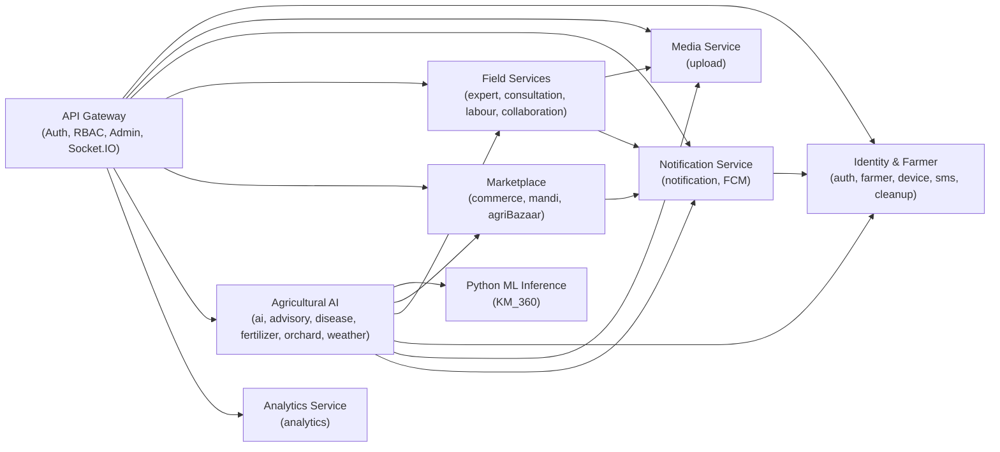

# CONTROLLER_SERVICE_MAPPING.md — Controller, Route & Module Mapping

## 1. Controller-to-Service Mapping

| Existing Controller / Module | Primary Routes | Target Microservice | Extraction Stage | Notes |
| --- | --- | --- | --- | --- |
| `upload.controller.ts` | `/api/uploads/*` | **7. Media Service** | **Stage 3** | Stateless (Cloudinary + audio storage); zero DB tables |
| `notification.controller.ts` | `/api/notifications/*` | **8. Notification Service** | **Stage 3** | Farmer inbox + FCM dispatch + admin broadcast telemetry |
| `expert.controller.ts` | `/api/experts/*` | **6. Field Services & Booking** | Stage 4 | Expert directory + staff provisioning |
| `consultation.controller.ts` | `/api/consultations/*` | **6. Field Services & Booking** | Stage 4 | Voice/Video/Chat scheduling & prescriptions |
| `labour.controller.ts` | `/api/labour-requests/*`, `/api/labour-help/*` | **6. Field Services & Booking** | Stage 4 | Farm labour demand, wage catalog & worker allocations |
| *Machinery (AI tool today)* | `book_machinery` -> future `/api/machinery/*` | **6. Field Services & Booking** | Stage 4 | Currently only exists inside `services/ai/tools/registry.ts` |
| `collaboration.controller.ts` | `/api/collaborations/*`, `/api/partnerships/*`, `/api/admin/collaborations/*` | **6. Field Services & Booking** *(Partnership Ops)* | Stage 4 | Audited: B2B/FPO/Agri-input partner proposal intake & verification workflow; admin routes orchestrated via gateway |
| `commerce.controller.ts` | `/api/commerce/*` | **5. Marketplace Service** | Stage 4 | Catalog, cart, checkout, orders & payments |
| `mandi.controller.ts` | `/api/mandi-prices/*` | **5. Marketplace Service** | Stage 4 | APMC commodity prices & trends |
| `agriBazaar.controller.ts` | `/api/agri-bazaar/*`, `/api/crop-buying-selling/*` | **5. Marketplace Service** | Stage 4 | Farmer produce listings, buyer procurement requests & supplier matching |
| `ai.controller.ts` | `/api/ai/*` | **3. Agricultural AI Service** | Stage 4 | Multi-agent orchestrator, conversation sessions, RAG, farmer memory |
| `advisory.controller.ts` | `/api/advisories/*` | **3. Agricultural AI Service** | Stage 4 | Crop advisories + `/crop-recommend` bridge to `KM_360` |
| `disease.controller.ts` | `/api/disease-requests/*`, `/api/disease-help/*` | **3. Agricultural AI Service** | Stage 4 | Crop pathology diagnosis, catalog & treatment plans |
| `fertilizer.controller.ts` | `/api/fertilizer-requests/*`, `/api/fertilizer-guide/*` | **3. Agricultural AI Service** | Stage 4 | Soil fertilizer schedules, catalog & plans |
| `orchard.controller.ts` | `/api/orchard-requests/*` | **3. Agricultural AI Service** | Stage 4 | Orchard survey planning, GPS/land specs & ROI report |
| `weather.controller.ts` | `/api/weather/*` | **3. Agricultural AI Service** | Stage 4 | Hyperlocal forecast & agricultural spraying alerts |
| `auth.controller.ts` | `/api/auth/*` | **2. Identity & Farmer Service** | Stage 5 | JWT issuance, OTPs, Firebase token verification, staff password login, audit logs |
| `farmer.controller.ts` | `/api/farmers/*` | **2. Identity & Farmer Service** | Stage 5 | Farmer profile CRUD, directory, 360-degree dossier |
| `device.controller.ts` | `/api/devices/*` | **2. Identity & Farmer Service** | Stage 5 | FCM push device registration (exposed read API for Notification Service) |
| `KM_360` FastAPI endpoints | `/ml/*`, `/api/v1/ml/*` | **4. Python ML Inference Service** | Stage 6 | Crop, soil, STCR fertilizer, disease CV, yield, smart irrigation |
| `analytics.controller.ts` | `/api/analytics/*` | **9. Analytics Service** | Stage 7 | Executive summary & legacy orchard dashboard analytics |
| `admin.controller.ts` | `/api/admin/users/*`, `/api/admin/system-health` | **1. API Gateway** *(initially)* | Stage 1–7 | Admin user CRUD delegates to Identity in Stage 5; system-health aggregates `/health` across microservices |

---

## 2. Background Jobs, Real-Time & Supporting Modules Mapping

| Module | Current Responsibility | Target Owner |
| --- | --- | --- |
| `services/sms.service.ts` | Fast2SMS OTP delivery | **2. Identity & Farmer Service** |
| `services/cleanup.service.ts` + `cleanup-handler.ts` | Purges expired `EmailOtp` & 90d `AuthAuditLog` | **2. Identity & Farmer Service** (scheduled worker / EventBridge) |
| `services/ml.service.ts` | HTTP client to `KM_360` + `MLModelRegistry` / `PredictionAuditLog` persistence | **3. Agricultural AI Service** (governance logs shared with **9. Analytics** via read/events) |
| `config/socket.ts` (`getIO()`) | Real-time Socket.IO room notifications for admin/expert dashboards | **1. API Gateway** / **8. Notification Service** (gateway exposes Socket.IO server & internal `/internal/realtime/emit` webhook) |

---

## 3. Dependency Diagram

