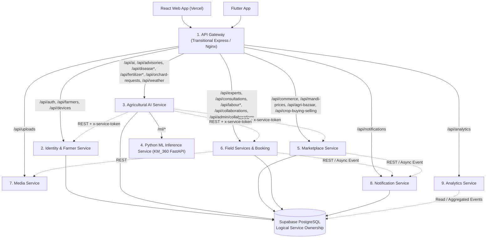

# TARGET_MICROSERVICES_ARCHITECTURE.md — Kissan Mithar Target Architecture

## 1. Architecture Summary

The Kissan Mithar backend transitions via the **Strangler Fig pattern** from the current modular Express monolith (`backend/`) into **9 domain-bounded microservices** while preserving **100% backward compatibility** for the React web portal (`web/`) and Flutter mobile app (`kissan_mithar_app/`).

---

## 2. The 9 Logical Microservices

| # | Service | Core Responsibility | Status in Strangler Migration |
| --- | --- | --- | --- |
| **1** | **API Gateway** (`backend/`) | Edge auth verification, RBAC guardrails, rate limiting, request ID correlation, version routing, admin orchestration, Socket.IO host, and Strangler Fig fallback | Active transitional gateway |
| **2** | **Identity & Farmer Service** | Authentication (JWT, Phone OTP, Email OTP, Firebase), farmer profiles, FCM device token registration, and `AuthAuditLog` | Stage 5 extraction |
| **3** | **Agricultural AI Service** | Conversational AI orchestrator, RAG knowledge retrieval, farmer memory, weather & agronomy workflows (orchard, fertilizer, disease workflows) | Stage 4 extraction |
| **4** | **Python ML Inference Service** (`KM_360/`) | FastAPI ML predictions: Crop suitability, Soil Health Card analysis, STCR fertilizer, Disease vision, Yield prediction, Smart irrigation | Existing independent service (`port 8000`); Stage 6 production hardening |
| **5** | **Marketplace Service** | Agri-input product catalog, shopping cart, checkout, orders, payment transactions, APMC Mandi prices, and AgriBazaar crop sourcing/matching | Stage 4 extraction |
| **6** | **Field Services & Booking Service** | Expert directory, scheduled farmer-expert consultations, farm labour requests/allocations, future machinery booking, and B2B collaboration/partnership intake | Stage 4 extraction |
| **7** | **Media Service** (`services/media-service`) | Cloudinary upload signature generation, voice note/media ingestion, persistent asset URL resolution | **Stage 3 extraction (First)** |
| **8** | **Notification Service** (`services/notification-service`) | In-app farmer notification inbox, FCM push dispatch, admin targeted broadcasts, and delivery telemetry | **Stage 3 extraction (Second)** |
| **9** | **Analytics Service** | Executive KPI summaries, turnaround time metrics, crop demand analytics, ML telemetry aggregation | Stage 7 extraction |

---

## 3. Architectural Principles Enforced

1. **No Controller-per-Service Anti-Pattern:** The 20 controllers map cleanly into 8 Node services + 1 Python ML service aligned with business capabilities.
2. **Transitional API Gateway & Zero Frontend Rewrite:** Existing `/api/*` paths remain unchanged on the gateway. Route prefixes are gradually switched via environment feature flags (`MEDIA_SERVICE_URL`, `NOTIFICATION_SERVICE_URL`, etc.).
3. **LLM Safety Boundary:** The Agricultural AI Service orchestrates LLM reasoning and tool calls, **never** writing directly to Marketplace `Order`/`PaymentTransaction`, Field `Consultation`/`LabourRequest`, or Identity `Farmer` tables. Business state changes occur through validated domain service APIs.
4. **Single-Writer Database Ownership:** Each PostgreSQL table has exactly one owning service. Cross-service mutations occur over authenticated REST or async events, never shared table writes.
5. **Admin Orchestration in Gateway:** `/api/admin/*` and `/api/admin/collaborations/*` remain behind gateway RBAC initially and delegate to domain service APIs as services extract.
6. **Clean Independence Per Extracted Service:** Each extracted service under `services/` maintains its own `package.json`, `tsconfig.json`, `Dockerfile`, `.env.example`, `README.md`, `src/index.ts`, routes, controllers, services, `/health` & `/readiness` probes, and independent tests.
